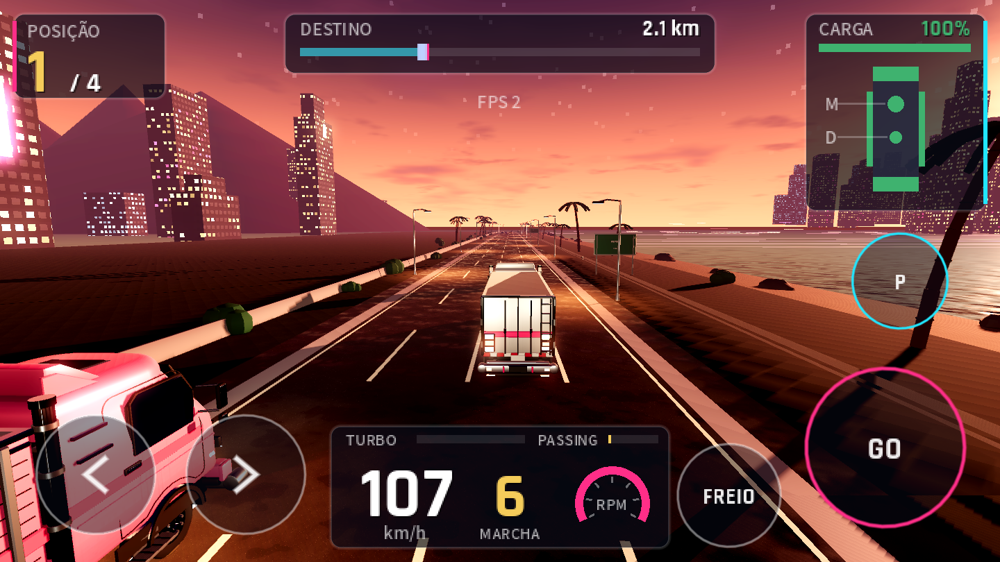
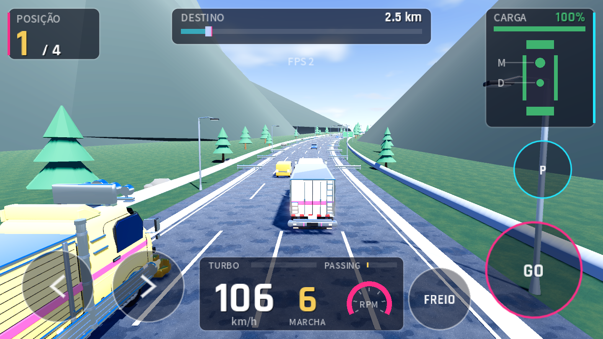
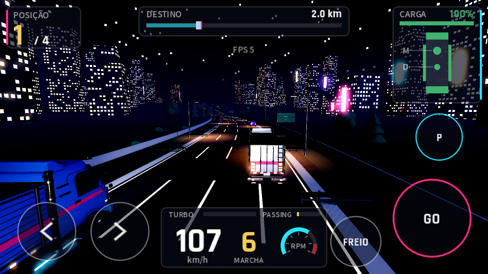
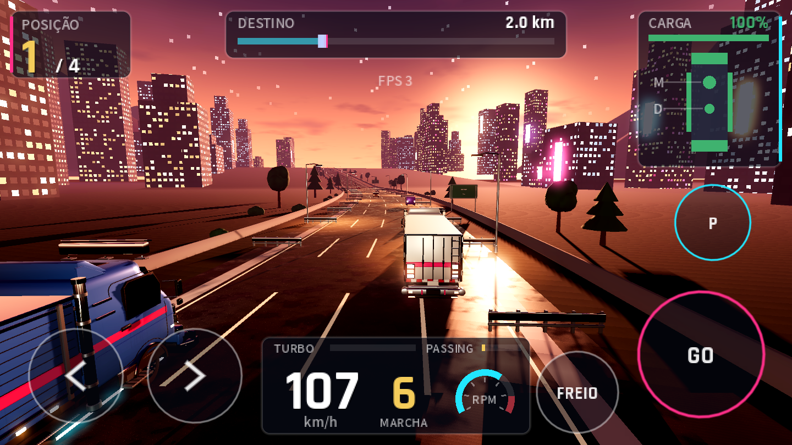
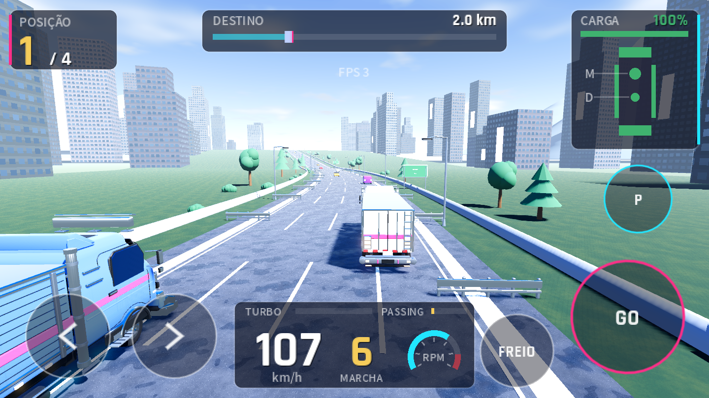

# Direção de arte da corrida: 3 propostas

Tarefa V1 do `docs/PLANO_VISUAL.md`. As capturas foram tiradas do **próprio jogo** com o sistema de hora do dia
(V2, presets em `game/data/time/`). Hoje cada rota já usa uma das três:

| Proposta | Preset | Rota que usa hoje |
| --- | --- | --- |
| A. Shuto à meia-noite | `night` | Tóquio (viaduto), `kanto_2_viaduct` |
| B. Hora mágica no litoral | `dusk` | Litoral, `kanto_1_coast` |
| C. Verão japonês | `day` | Hakone (montanha), `kanto_3_mountain` |

**Decisão do Marco:** escolher uma identidade principal (vira a capa, o trailer e a maioria das rotas) ou manter
as três, uma por região. Trocar a hora de uma rota é mudar uma linha: `time_of_day = &"dusk"` no `.tres` da rota.
Para testar qualquer preset em qualquer rota: `godot --path game res://scenes/race/race3d.tscn -- --time=day`.

## Lado a lado

| A. Shuto à meia-noite | B. Hora mágica no litoral | C. Verão japonês |
| --- | --- | --- |
|  |  |  |

Mesmo ponto da pista (Tóquio, 700 m) nas três horas:

| night | dusk | day |
| --- | --- | --- |
|  |  |  |

## A. "Shuto à meia-noite"

- **Clima:** via expressa urbana às 2 da manhã; quase tudo preto, a luz vem dos postes, janelas e neon.
- **Paleta (10):** céu `#02030a`, horizonte `#0b1030`, brilho da cidade `#3d1a0e`, sódio `#ff9e40`,
  neon rosa `#ff2e88`, neon ciano `#21e6ff`, janela quente `#ffcc73`, janela fria `#bfe0ff`, asfalto molhado `#16161c`, luar `#8ea6ff`.
- **Luz:** luar frio e fraco (0,6), postes de sódio pintados no asfalto, faróis acesos. Glow forte (limiar 0,9).
- **Céu:** gradiente quase preto, estrelas e lua; brilho laranja da cidade colado no horizonte.
- **Materiais:** asfalto úmido (rugosidade 0,55), cromo reflete as luzes (melhora com V6).
- **Força:** é a cara clássica de Dekotora: as luzes do caminhão brilham mais que tudo.
- **Risco:** escuro demais em tela de celular com brilho baixo; precisa das marcações da V3 para ler a pista.

## B. "Hora mágica no litoral"

- **Clima:** pôr do sol na baía, silhuetas dos prédios, mar refletindo o céu, faróis já acesos.
- **Paleta (10):** céu alto `#121438`, horizonte `#db6b54`, sol `#ff9e52`, brilho `#ff8538`, nuvens `#8c4d61`,
  mar `#0d0f24`, areia `#6b5040`, sódio `#ff9e40`, neon rosa `#ff2e88`, janelas `#ffcc73`.
- **Luz:** sol baixo laranja (1,0) contra a câmera, sombras longas, postes já acesos (metade da força).
- **Céu:** gradiente violeta → laranja, disco do sol com halo, nuvens rosadas andando devagar.
- **Materiais:** asfalto meio úmido reflete o sol; mar com ondas por shader.
- **Força:** a mais bonita em captura e a mais "cartão-postal"; ótima para a tela inicial.
- **Risco:** o contraluz deixa o caminhão da frente escuro; tudo fica laranja se exagerar.

## C. "Verão japonês"

- **Clima:** meio-dia de verão na serra, céu azul com nuvens altas, sombras duras, Monte Fuji ao fundo
  (silhueta no céu, aparece nas retas quando as montanhas próximas não tapam).
- **Paleta (10):** céu `#215cc7`, horizonte `#a8c7e6`, nuvem `#ffffff`, sol `#fff7e0`, grama (textura),
  floresta `#1a2624`, Fuji `#4a5a7a` com neve, asfalto seco `#5a5a5e`, faixa branca `#f2f2f2`, concreto `#9a9da4`.
- **Luz:** sol forte (2,1) a 52° de altura, sombra só no modo alto (no médio custaria +50% de chamadas de desenho).
- **Céu:** gradiente azul, duas camadas de nuvens que se movem, sol com halo; sem estrelas.
- **Materiais:** asfalto seco (rugosidade 0,9), vidro dos prédios reflete o céu, sem neon.
- **Força:** a mais legível e a mais leve no celular (sem glow forte); mostra bem a pintura do caminhão.
- **Risco:** é a que mais denuncia modelos simples (árvores low-poly, montanhas em cone): depende da V4.

## Recomendação

Manter as três, uma por rota (é o que já está ligado), e usar a **A** como identidade principal (logo, menu,
trailer), porque é a que valoriza as luzes do Dekotora. A **B** fica para a tela inicial e a **C** para dar
variedade. Se o celular medir pouco desempenho (V8), a **C** é a mais leve.
