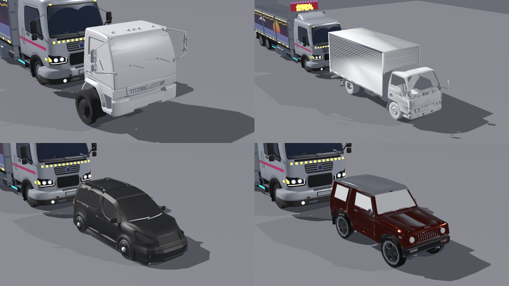
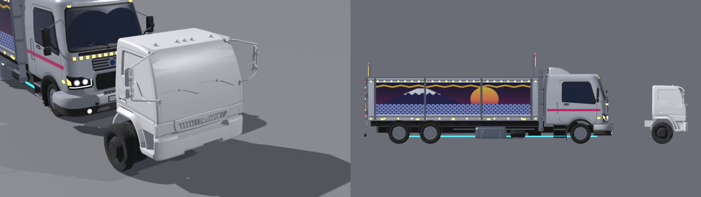
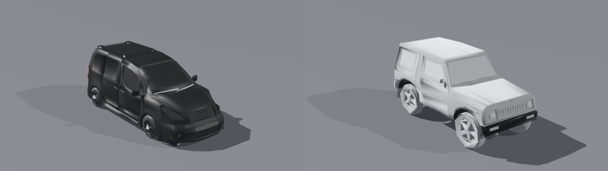

# Modelos de terceiros em `docs/Novos modelos/`: análise (T-115)

Data: 2026-10-17. Pedido do Marco: "analisa os arquivos da pasta docs\Novos modelos, tem alguns modelos de carro e caminhão.
Verificar se é possível implementar no jogo e tem até cabine."

**Só análise.** Nada do jogo foi alterado e nada dentro de `docs/Novos modelos/` foi mexido. A pasta tem 1,1 GB, está no
`.gitignore` e não pode ir para o Git. Testes feitos no Blender 5.2.2 e no Godot 4.7.2 em linha de comando. Os arquivos de teste
ficam em `blender/renders/t115/` (fora do Git).

## Resumo em uma tela

| Modelo | O que é de verdade | Serve? | Por quê |
| --- | --- | --- | --- |
| `Caminhão/canter.obj` | Mitsubishi Fuso **Canter** antigo (anos 80/90) com baú de alumínio; logotipo da Mitsubishi na grade | **Não serve** | Quase certamente **extraído de outro jogo** (nomes `mesh_16_77.nr` = ferramenta Ninja Ripper), sem vidros, sem texturas (falta o `.mtl`), malha em triângulos soltos. Risco legal alto e qualidade baixa |
| `Cabine/CF_500_*` | Cabine **International CF500** (Navistar; ao que parece, prima da CityStar vendida no Brasil; **não é DAF**), estilo "cara chata" japonês; logotipo da International na grade e na porta | **Serve com trabalho**, se a licença permitir | Superfície limpa (CAD), forma muito boa e peças separáveis. Mas vem sem cor, sem UV e sem nomes, é mais baixa e mais curta que as nossas cabines e tem marca registrada |
| `Carro/` | **Suzuki Samurai / SJ (Gypsy)**, jipe de 2 portas; "SUZUKI" escrito na grade | **Serve com trabalho** (tráfego) | Bem modelado, mas tudo fundido numa malha só, 50 texturas 4K (315 MB) e escala errada. Licença do autor desconhecida |
| `Van+01/` | Furgão no estilo **Peugeot Partner / Citroën Berlingo** (2ª geração), rebaixado, com rack | **Serve com trabalho** (tráfego) | O mais fácil: peças com nomes e rodas separadas, cai para 6 mil triângulos sem estragar. Os grafismos das imagens de preview **não vêm** (são materiais V-Ray). Parece produto de loja: o Marco precisa ter comprado |

**Recomendação curta:** nenhum entra no jogo antes de o Marco confirmar **de onde baixou e qual licença** tem. Se a licença
permitir, a ordem que vale a pena é: (1) a **van** e o **carro** como tráfego (pouco trabalho e ganho visível), (2) a **cabine CF500**
como 5ª cabine (bastante trabalho e ganho grande, mas é preciso apagar a marca). O **Canter** fica fora.

*Os 4 modelos depois da conversão (decimados), na mesma escala do caminhão atual do jogo (atrás de cada um). Na ordem:
cabine CF500 (40 mil triângulos), Canter (40 mil), van (20 mil) e carro (30 mil).*

## 1. O que é cada um e qual arquivo usar

| Pasta | Arquivos | Abre no Blender 5.2? | Caminho viável |
| --- | --- | --- | --- |
| Caminhão | `canter.obj` (17 MB, gravado pelo Blender 3.0 em 2022) | OBJ abre. O `canter.mtl` **não veio**: o Blender avisa e os materiais ficam sem cor | `canter.obj` (o único) |
| Cabine | `CF_500_complete.3dm` (Rhino 4), `.stp` (STEP, 2012), `.stl` (30 MB) + 3 renders | **STL abre.** O `.3dm` e o `.stp` não abrem direto (o 3DM pede a extensão "Import Rhino 3DM"; o STEP pede o FreeCAD) | `CF_500_complete.stl`. Conferi o STEP: são 278 corpos (104 sólidos e 174 superfícies), **sem nomes, sem cores e sem montagem**, ou seja, não ajuda mais que o STL |
| Carro | `blender.blend` (480 MB), `fbx/*.fbx`, `obj/obj.obj + .mtl`, `stl/stl.stl`, `textures/` (198 PNG, 315 MB) | OBJ e FBX abrem. O `.blend` também abre, mas pesa 480 MB (texturas embutidas e ~30 materiais do BlenderKit) | `obj/obj.obj`, religando as texturas pela pasta `textures/` (o `.mtl` aponta para `C:/` e o FBX para `F:\blender\fooroosh\car\`) |
| Van | `Export File/van.FBX`, `van.obj + .mtl`, `Texture/*.jpg` (6), `Preview/*.jpg` (4), `van 01.max` (3ds Max 2018) | FBX e OBJ abrem. O `.max` só abre no 3ds Max | `van.FBX`: tem os 19 materiais e a malha base. O OBJ tem um material só (`wire_115115115`) e vem com a suavização aplicada (718 mil triângulos) |

## 2. Números medidos (importando no Blender)

| | Canter | Cabine CF500 (STL) | Carro (OBJ) | Van (FBX) |
| --- | --- | --- | --- | --- |
| Objetos / malhas | 22 malhas | 1 malha | 1 malha | 54 objetos |
| Triângulos | 129.583 | **609.630** | **436.059** | **504.334**, dos quais 470.592 (93%) são **2 objetos de pneu** |
| Tamanho como vem | 7,42 × 2,46 × 3,24 m (escala real) | 21,9 × 36,5 × 29,8 "unidades" (sem escala) | 6,34 m de comprimento (escala errada, ×1,6) | 1,56 m de comprimento (escala errada, ×1/2,8) |
| Escala usada no teste | 1,0 | 0,0948 (largura do corpo = 2,4 m, igual à `CAB_W`) | 0,742 (comprimento de 3,95 m, como o Samurai/Gypsy) | 2,80 (comprimento de 4,38 m, como o Partner) |
| Eixo para cima / frente | Z / +X | Z / +X | Z / +Y | Z / −Y |
| Materiais | 3 (`mat_0`, `mat_7`, `mat_23`), sem textura | nenhum | 22 a 24 PBR ("Car Paint", "Car chrome", "DRL Emission"...) | 19 V-Ray (pintura, vidro fumê, alumínio, PVC...) |
| Texturas | nenhuma (falta o .mtl) | nenhuma | 50 usadas, **49 em 4096×4096**. Várias são **cor lisa em 4K** (arquivos de 58 KB) | 3 usadas: 2048², 2048², 2968×979. Mais 8 mapas V-Ray que não exportam (viram magenta) |
| UV | sim | **não** | sim | sim |
| Peças separadas | parcial: 22 grupos, mas 15.856 "ilhas" de triângulos soltos (vértices duplicados, típico de extração de jogo). Soldando, viram 457 peças | **201 peças soltas em pares espelhados** (casca esquerda/direita com ~14,5 mil triângulos cada, para-brisa em 2 metades, janelas, para-lamas, rodas), sem nomes | tudo fundido numa malha; dá para separar 95 peças soltas (as rodas saem certinho) | **sim, com nomes**: `Tire*`, `Front_light_*`, `Small_light_*`, `Plane002` (carroceria), rack (`Box*`) |
| Limpeza | **ruim**: 140 mil arestas abertas, **sem vidros** (dá para ver os bancos), frente embolada | boa (superfície de CAD), casca sem interior (só o piso), 15 mil arestas abertas nas bordas | boa: 3,7 mil arestas abertas | boa; pneus com densidade absurda (235 mil triângulos cada) |

## 3. Orçamento do jogo e teste de conversão

Hoje: caminhão do jogador de ~52 a 77 mil triângulos (64 mil no padrão); carros do tráfego com **~2,7 mil triângulos e 6 a 7
materiais** cada (`game/assets/vehicles/traffic/*.glb`); cena de corrida com ~125 a 160 mil triângulos no modo médio.

**Teste real feito** (script `blender/renders/t115/scripts/convert.py`, fora do Git): importa, gira com a frente para +Y,
solda os vértices, separa as peças soltas, **acha as rodas sozinho** (peças redondas embaixo) e junta cada uma num objeto
`wheel_f*`/`wheel_r*` com o pivô no centro (o mesmo nome que o `TruckNode` procura para girar). Depois põe na escala, decima
(Decimate Collapse), gera UV quando falta e exporta `.glb`.

| Modelo | Triângulos antes → depois | `.glb` | Tempo | Rodas achadas | Godot 4.7.2 (`--import` + carregar) |
| --- | --- | --- | --- | --- | --- |
| Cabine CF500 | 609.630 → **40.000** (37,6 mil cabine + 2 × 1,2 mil rodas) | **1,40 MB** | 14 s | 2 | OK: 40.000 triângulos, 3 superfícies, 2 rodas, 3,46 × 2,83 × 2,08 m |
| Van | 504.334 → **20.000** | 0,97 MB | 14 s | 4 | OK: 19.999 triângulos, **32 superfícies** |
| Carro | 436.059 → **30.000** | **15,7 MB** (50 texturas reduzidas para 1024²) | 68 s | 4 | OK: 29.999 triângulos, **40 superfícies** |
| Canter | 129.583 → 40.000 | 1,49 MB | 8 s | 4 | OK: 39.995 triângulos, 6 superfícies |
| Van (tráfego) | 504.334 → **6.000** | 0,38 MB | — | 4 | (mesmo processo) |
| Carro (tráfego, sem texturas) | 436.059 → **6.000** | 0,32 MB | — | 4 | (mesmo processo) |

O Godot importou os 4 `.glb` sem erro num projeto temporário (`blender/renders/t115/godot_test/`, script `check.gd`),
com renderizador Compatibility e compressão ETC2/ASTC (a mesma do celular).

**Conclusões do teste:**

- **Dá para chegar a 30–60 mil triângulos** em todos, em segundos. A decimação automática segura bem a **cabine CF500 em 40 mil**
  e a **van em 6 a 20 mil**. No **carro em 6 mil**, as rodas com 300 triângulos ficam poligonais: precisam de 600 a 800.
- O que pesa **não são os triângulos**, são os **materiais e as texturas**. Carro com 40 superfícies e van com 32 dão 30 a 40 chamadas
  de desenho **por carro**; os carros do tráfego atual têm 6 a 7. Para o celular, cada modelo de tráfego precisa cair para **1 a 3
  materiais com um atlas de 1K** (ou cores lisas, como os carros atuais). As texturas 4K do carro são quase todas cor lisa: dá para
  trocar por cor no material e o `.glb` cai de 15,7 MB para ~0,3 MB.
- A decimação não separa vidro, farol e pintura. Na CF500 isso precisa ser feito **à mão** (as peças existem, mas sem nome).

*Cabine CF500 com 40 mil triângulos, escala de 2,4 m de largura, ao lado do caminhão padrão (frente e perfil ortográfico).
Repare que ela é ~0,5 m mais baixa e ~1 m mais curta que a cabine do jogo.*

*Van e carro decimados para 6 mil triângulos (orçamento de tráfego). O carro aparece sem texturas.*

## 4. Encaixe no jogo

> **T-129:** as cabines por código (`truck3d/cab.py` e módulos) foram retiradas; as referências a `cab.py`/`cab_surface` abaixo são históricas.

### Cabine CF500 como 5ª cabine (`--cab cf500`)

É o que mais tem a cara do pedido ("tem até cabine"): o formato **cara chata** é o mesmo dos caminhões japoneses que viram Dekotora.
O que precisaria:

1. **Separar e pintar** (no Blender, à mão, uma vez): escolher, entre as 201 peças, quais são vidro, grade, faróis, para-choque,
   espelhos e casca, e dar a elas os **nossos materiais** (`pbr.truck_set`). A casca precisa de um nome com `paint_white`, porque
   é assim que `TruckNode.set_paint_color` pinta os rivais.
2. **Apagar a marca**: o losango da International na grade, o "INTERNATIONAL" na porta e o emblema do modelo na outra porta (nos renders).
3. **Escala e encaixe no chassi** (`dims.py`): com 2,4 m de largura, ela fica com 2,08 m de comprimento (a nossa cabine ocupa 3,05 m,
   de `CAB_Y0` = 8,45 a `CAB_Y1` = 11,5) e o teto a 2,83 m (o nosso `CAB_TOP` é 3,35; o baú vai a 3,2). Alinhando a frente em
   `CAB_Y1`, sobra ~1 m de vão até o baú: precisa de uma **extensão traseira (dormitório)** e do **defletor de teto** (já existe
   em `cab_roof.py`) para a cabine não ficar "afundada" na frente do baú.
4. **Rodas**: jogar fora as rodas dela e usar as nossas (`wheels.py`, raio 0,52; as dela dão 0,57 nessa escala). Assim o giro e o
   esterço do `TruckNode` funcionam igual às outras cabines.
5. **Pontos de montagem das 32 peças**: o código já aceita âncoras próprias por cabine (`cab.py`, função das âncoras de teto e visor).
   Seria preciso uma tabela para a CF500: visor, teto e luzes de teto em 2,83 m, e para-choque, grade e enfeite na frente dela. A
   grade cromada de acessório cobre a grade pequena original sem problema.
6. **Decoração V7** (fileiras de luzes, andon, sobrancelha de luz): hoje `deco.py` cola as luzes na **nossa** casca (`cab_surface.patch`).
   Numa malha importada, as posições teriam que ser tiradas da superfície dela (projeção nos pontos mais próximos) ou feitas à mão. Isso é
   código novo.
7. **UV e texturas**: o STL não tem UV. O teste gerou UV automática (Smart UV), que basta para as nossas texturas por código
   (pintura suja, vidro com arco do limpador).

Custo estimado: **2 a 3 sessões de especialista** (separar e pintar, encaixe e âncoras, decoração e conferência). Risco médio: a
proporção dela é de caminhão **médio**; esticada para 2,4 m fica "baixinha" ao lado do baú de 3,2 m. Há também uma questão de
pipeline: hoje toda a arte nasce de script dentro do repositório, e este modelo dependeria de um arquivo de fora (não pode ir para o
Git). Só o `.glb` final entraria, e só com licença.

**Ganho visual:** grande na cabine (curvas reais, limpadores, luzes de teto, braços de espelho americanos, para-lama). É a melhor forma
de cabine que temos hoje, melhor que as 4 feitas por código.

### Canter inteiro como caminhão (jogador, rival ou tráfego)

**Não.** (a) Origem: os nomes `*.nr` são do **Ninja Ripper**, programa que copia modelos da memória de um jogo em execução; tudo indica
que é arte de outro jogo, sem direito de uso. (b) Qualidade: sem vidros, sem texturas, triângulos soltos e frente embolada depois da
decimação. (c) Tamanho: é um caminhão leve (7,4 m), não um Dekotora de 12 m (o hitbox da simulação é `Collision.LEN` = 12 m).
Como **tráfego** ele seria perfeito (é o caminhão-baú mais comum das estradas japonesas), mas, se quisermos esse tipo de veículo,
o certo é modelar um parecido no nosso pipeline (já existe o baú "leve" de 5,4 m).

### Carro e van como tráfego da estrada

Hoje o tráfego usa 4 modelos genéricos feitos por código (`car_hatch`, `car_sedan`, `car_van`, `car_kei_truck`), com ~2,7 mil
triângulos e pintura trocada por cor (`traffic_3d.gd` troca o material `paint_white`).

- **Van**: fácil. Rodas separadas e peças com nomes. Decimar para 4 a 6 mil triângulos, juntar os 19 materiais em 3 (pintura `paint_white`,
  vidro, cromo/plástico) e trocar a pintura do preview por cor lisa (o sistema de cores do tráfego já faz isso). Cerca de **1 sessão**.
  Ganho: médio. É bem mais detalhada que o `car_van` atual, mas tem cara europeia.
- **Carro (Samurai/Gypsy)**: médio. Separar as peças da malha única por material, apagar o "SUZUKI" da grade, trocar as 50 texturas 4K
  por cores, decimar para ~6 mil (rodas com 600 a 800). Cerca de **1 sessão**. Ganho: médio e combina com o Japão (é o "irmão" do Jimny).
- Cuidado com o desempenho: são dezenas de carros na pista. Cada modelo novo com 6 mil triângulos dobra o custo de cada carro do
  tráfego. O ideal é **LOD** (versão de ~1,5 mil de longe), o que já está pendente para os caminhões.

## 5. Licença e origem (com franqueza)

Nenhum arquivo traz texto de licença, nome de site ou URL de compra. Os indícios encontrados nos próprios arquivos:

| Modelo | Indícios | Risco |
| --- | --- | --- |
| Canter | OBJ salvo de `canter.blend` (Blender 3.0, 2022); objetos `mesh_0_7.nr`, `mesh_16_77.nr`... (padrão de **extração de jogo, Ninja Ripper**); vértices todos duplicados (típico de extração da placa de vídeo); logotipo **Mitsubishi** | **Muito alto.** Arte copiada de outro jogo + marca registrada. Não usar |
| Cabine CF500 | STEP de 2012-10-18 "CF 500 complete", sem autor; o 3DM diz **"Rhinoceros 4.0 – Licencia Lab educacional"** (licença de laboratório de ensino, em espanhol); pasta "Renderings(1325)" no formato de sites de CAD comunitários (ex.: GrabCAD). Logotipo e nome **International** (Navistar) | **Alto até provar o contrário.** Trabalho de estudante sem licença declarada; sites de CAD comunitário normalmente não dão licença comercial automática. A marca precisa ser apagada de qualquer jeito |
| Carro | Feito no Blender 3.5.1 (2023), pasta do autor `F:\blender\fooroosh\car\`; o `.blend` tem ~30 materiais do **BlenderKit** (85 marcados "royalty_free", 7 "cc_zero") e o caminho `C:\Users\alire\OneDrive\...`; "SUZUKI" na grade | **Médio-alto.** Autor desconhecido; formato de produto de loja (blend + fbx + obj + stl + texturas). Os materiais BlenderKit "royalty_free" têm regras próprias. Marca Suzuki |
| Van | 3ds Max 2018 + V-Ray, usuário **`foad3dcube`**, exportado em 13/10/2020; pastas "Export File/Preview/Texture" e 4 imagens de preview com pinturas diferentes (formato de produto à venda em lojas como CGTrader/TurboSquid). Desenho de **Peugeot Partner/Citroën Berlingo**, sem logotipo visível | **Médio.** Se o Marco **comprou** numa loja, a licença padrão dessas lojas costuma permitir usar dentro de um jogo vendido (sem redistribuir os arquivos). Se veio de site de "download grátis" que repassa modelos pagos, é pirataria |

**O que o Marco precisa confirmar antes de qualquer passo:**

1. **De onde baixou cada um** (link da página) e **se pagou**.
2. **Qual licença** a página mostra. Procurar: "Royalty Free", "Standard License", "CC0", "CC-BY" (exige dar crédito), "Editorial"
   ou "personal use only" (estes dois proíbem o jogo), "No AI/No games".
3. Para os de marca (Mitsubishi, International, Suzuki, e o desenho Peugeot/Citroën): mesmo com licença do modelo, **a marca não está
   licenciada**. A prática segura é apagar logotipos e nomes. Para publicar na Play Store, o mais seguro é que o carro não pareça uma
   cópia exata de um modelo real.

Sem essa confirmação, a recomendação é **usar só como referência visual** (olhar formas e proporções para melhorar as nossas cabines
feitas por código), o que não copia o arquivo de ninguém.

## 6. Recomendação em passos (cada passo vira uma tarefa)

| # | Passo | Quem | Depende de |
| --- | --- | --- | --- |
| 0 | Marco informa a origem e a licença dos 4 modelos (links, se pagou) | Marco | — |
| 1 | **Van → tráfego**: decimar para ~5 mil, 3 materiais (`paint_white`, vidro, cromo/plástico), rodas `wheel_*`, `.glb` em `game/assets/vehicles/traffic/car_van2.glb`, entrar na lista do `traffic_3d.gd`, medir chamadas de desenho | especialista | 0 (licença ok) |
| 2 | **Carro → tráfego**: separar a malha por material, apagar "SUZUKI", trocar as texturas 4K por cores, ~6 mil triângulos com rodas de 700 | especialista | 0 |
| 3 | **CF500, fase A**: separar e nomear as peças (vidro, grade, faróis, para-choque, espelhos, casca), apagar a marca, nossos materiais, UV, nossas rodas; `.glb` de conferência ao lado das 4 cabines | especialista | 0 |
| 4 | **CF500, fase B**: extensão traseira + defletor, tabela de âncoras própria, decoração V7 posicionada na casca dela, combinação com os 3 baús (`--cab cf500`), escolha na garagem | especialista | 3 + aprovação visual do Marco |
| — | **Canter**: descartar (não usar nem como tráfego). Se quiser um caminhão-baú leve japonês no tráfego, modelar um no nosso pipeline | — | — |

**Alternativa sem risco de licença** (se a origem não puder ser confirmada): usar os renders e as medidas da CF500 como **referência**
para uma 5ª cabine feita por código no nosso `truck3d/cab.py` (formato cara chata, para-brisa largo, braços de espelho, luzes de
teto). Dá menos detalhe que o modelo pronto, mas é 100% nosso.

## Como conferir

- Imagens: `docs/direcao_arte/novos_modelos_todos.png`, `novos_modelos_cf500.png` e `novos_modelos_trafego_6k.png`.
- Arquivos do teste (fora do Git): `blender/renders/t115/convert/*.glb`, `*_report.json`, renders `*_34front.png`, `*_side.png`,
  `*_34rear.png`; medições em `blender/renders/t115/measure/`.
- Refazer o teste de uma cabine:
  `blender -b --factory-startup -P blender/renders/t115/scripts/convert.py -- stl "docs/Novos modelos/Cabine/CF_500_complete.stl" <pasta> cf500 --rotz 90 --fit width --size 2.4 --target 40000 --uv`
  (use **caminhos absolutos** na pasta de saída; caminho relativo vai parar em `C:\blender\...`).
- Godot: `godot --headless --path blender/renders/t115/godot_test --import` e depois `godot --headless --path blender/renders/t115/godot_test -s res://check.gd`.
